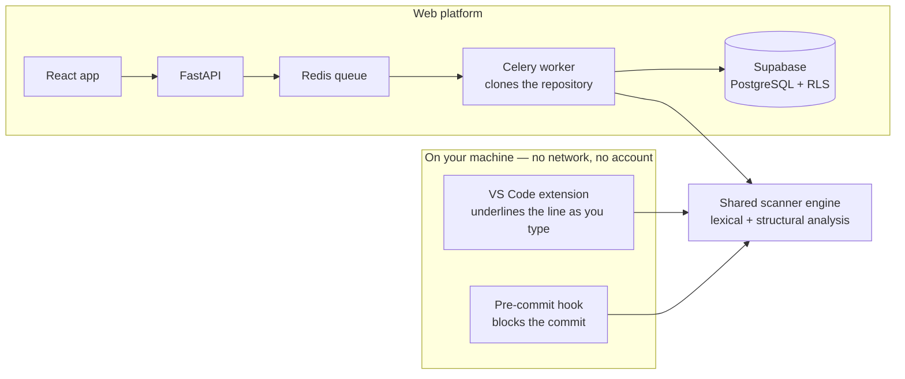

# DedSec

<p align="center">
  
  
  
  
  
  
</p>

**Security vulnerabilities flagged while you type, and blocked before they are committed — not discovered after they are public.**

DedSec is a static analysis tool that runs the same detection engine in three places: inside **VS Code** as you write, in a **Git pre-commit hook** that refuses vulnerable commits, and on a **web platform** that scans any public GitHub repository and produces a scored report.

- **Web platform:** https://dedsec-security.vercel.app
- **VS Code extension:** [DedSec on the Marketplace](https://marketplace.visualstudio.com/items?itemName=DedSec.dedsec) — or search for **DedSec** in the Extensions panel

---

## Why

Most scanners run after the code has been pushed. By then a hardcoded password in a public repository has already been exposed, and automated bots harvest credentials from new commits within minutes. DedSec moves the check to the moment the code is written and to the moment it is committed, so the vulnerable line never leaves the developer's machine.

Every finding comes with the file and line, a severity, its [CWE](https://cwe.mitre.org/) identifier, its [OWASP Top 10](https://owasp.org/Top10/) category, the offending snippet and a concrete fix.

## How it works



One engine, one set of rules: the editor, the hook and the website always agree on what is a vulnerability.

The engine uses only the Python standard library. That is what lets it run inside the extension without installing anything, and fast enough to keep up with typing: about **0.9 ms per file** in the editor and **~420 files per second** on a full project.

## What it detects

**Lexical layer** — 31 rules covering 16 CWEs, applied to 18 file types (`.py .js .ts .jsx .tsx .php .rb .java .go .html .htm .env .cfg .conf .ini .yaml .yml .json`).

| OWASP Top 10 (2021) | Examples | CWE |
|---|---|---|
| A01 Broken Access Control | path traversal, IDOR, mass assignment from `req.body`, routes without authentication | 22, 306, 639, 915 |
| A02 Cryptographic Failures | hardcoded passwords, tokens and cloud keys, private keys, weak hashes, TLS verification disabled | 295, 321, 327, 798 |
| A03 Injection | SQL built by concatenation, `os.system` / `shell=True`, `innerHTML` / `document.write`, `eval` / `exec` | 78, 79, 89, 95 |
| A05 Security Misconfiguration | CORS wildcard, debug mode on, environment variables returned in a response | 94, 200, 942 |
| A08 Software and Data Integrity Failures | `pickle.loads`, unsafe `yaml.load` | 502 |

**Structural layer (Python only)** — parses the file into an abstract syntax tree and runs 6 checks that need to understand the code, not just its text: `pickle` deserialization, `yaml.load` without `SafeLoader`, `eval`/`exec` on a non-constant argument, `subprocess` with `shell=True`, mass assignment, and routes with an ID parameter but no authentication dependency.

The structural layer is what tells `eval("1 + 1")` (harmless constant) apart from `eval(user_input)`.

## How to use

There are two ways to use DedSec: the VS Code extension and the web platform.

### VS Code extension

1. Open the Extensions panel (`Ctrl+Shift+X`), search for **DedSec** and install it — or run `ext install DedSec.dedsec` from the command palette.
2. Make sure **Python 3.11 or newer** is installed and on your `PATH`.
3. Open a **folder** (not a loose file) and start typing. Vulnerable lines are underlined; hover for the explanation, the fix and a link to the CWE page.

| Command / setting | What it does |
|---|---|
| `DedSec: Analisar arquivo atual` | Scans the active file |
| `DedSec: Analisar projeto inteiro` | Scans the whole workspace |
| `dedsec.runOn` | `type` (default) or `save` |
| `dedsec.pythonPath` | Python interpreter to use (user settings only) |

Everything runs on your machine: your code is never sent anywhere.

### Web platform

Sign in at **https://dedsec-security.vercel.app** (email and password, or Google), paste the URL of a public GitHub repository and follow the scan in real time. The report shows the score, totals by severity and every finding with its snippet and fix. It can be exported to PDF, and two scans of the same repository can be compared to see what was fixed, what is new and what remains.

The interface is available in Portuguese, English, Spanish, Russian, Italian and French.

> The API runs on a free hosting plan that sleeps when idle, so the first request after a while can take up to a minute.

## Ignoring a finding

Add a comment on the line, or on the line right above it:

```python
digest = hashlib.md5(data).hexdigest()  # dedsec: ignore
# dedsec: ignore[CWE-327]
digest = hashlib.md5(data).hexdigest()
```

Without a list, every finding on that line is ignored; with `[CWE-…]` (or the finding type), only that one. The extension's quick fix (`Ctrl+.`) inserts the comment for you. Because suppressions live in the code, they go through code review like everything else.

To ignore folders, files or whole rules across a project, add a `.dedsec.toml` at its root:

```toml
ignore_paths = [
  "tests/",                 # folders end with "/"
  "*.min.js",               # files accept wildcards
]

ignore_rules = ["CWE-327"]  # silence a CWE or a finding type project-wide
```

## Security score

Reports on the web platform include a score from 0 to 100. It starts at 100 and subtracts 20 per critical, 10 per high, 5 per medium and 2 per low finding — with diminishing weight: findings are sorted by severity and each penalty is divided by its position, so the worst one counts in full, the second counts half, the third a third, and so on. One critical issue drops the score sharply; the difference between 40 and 50 issues does not distort it.

## Architecture

| Layer | Technology |
|---|---|
| Scanner engine | Python 3.11 standard library (`re`, `ast`) |
| API | FastAPI, Pydantic, Uvicorn |
| Background scans | Celery with Redis as the broker |
| Database and auth | Supabase — PostgreSQL with row-level security, Supabase Auth (JWT) |
| Web interface | React 19, TypeScript, Vite, Tailwind CSS, TanStack Query, jsPDF |
| Editor | VS Code extension (JavaScript) with the scanner bundled |
| Hosting | Render (API, worker and Redis), Vercel (interface) |

The project is covered by 31 automated unit tests, including authorization between users, rate limiting, input validation and the protections described below.

## Security

DedSec handles code written by strangers, so the platform itself is built defensively:

- **Analyzed code is never executed.** Repositories are only read, never built or run.
- **Repositories are cloned with symbolic links disabled**, and only regular files inside the repository are read — a repository cannot make the server read its own files.
- **Size limit:** repositories over 100 MB are refused before cloning; clones time out after 60 seconds.
- **Users only see their own data.** The API filters every query by the authenticated user, and the database enforces the same rule with row-level security; the browser has read-only access.
- **Tokens are verified by Supabase**, never decoded and trusted locally; a successful check is cached for at most 30 seconds.
- **Rate limiting** per user, backed by Redis.
- **The VS Code extension never runs code from the opened project:** it uses only its bundled scanner, calls Python by absolute path, and its interpreter setting cannot be changed by a project's `.vscode/settings.json`.

Found a vulnerability in DedSec itself? Please report it privately — see [SECURITY.md](SECURITY.md).

## Limitations

- The structural layer only understands Python; the other languages get the lexical rules.
- Lexical rules can flag code that only *looks* dangerous. The suppression comment and `.dedsec.toml` exist for that.
- Static analysis cannot see flaws in an application's logic. Two access-control flaws found during DedSec's own development were **not** detected by DedSec — a reminder that this kind of tool complements code review, it does not replace it.

## About

DedSec was designed and built by **Álefe Alexandre de Toledo** as his final project (Trabalho de Graduação) for the Systems Analysis and Development program at **FATEC Cruzeiro – Prof. Waldomiro May**, Brazil, under the supervision of Prof. Me. Eduardo Compasso Arbex.

The name is a nod to the hacker collective of the game *Watch Dogs*.

## License

© 2026 Álefe Alexandre de Toledo. All rights reserved.

The source code is public for portfolio and academic evaluation only. Using, copying, modifying or redistributing it is not permitted. To use DedSec, install the extension or use the web platform. See [LICENSE](LICENSE).
